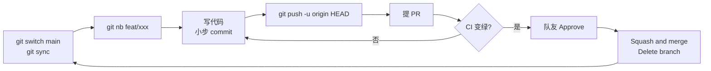

# 三人 Git 协作流程指导书

> 给零经验团队。读完这一份就够，不需要再找别的 Git 教程。
> 仓库落地位置：`docs/git-workflow.md`

---

## 0. 先背这三条铁律

1. **main 上永远不写代码。** 一行都不写。
2. **开工第一件事是 `git sync`。** 不是写代码。
3. **只动自己的目录。** 要动别人的，先在群里说一声。

违反任意一条，收拾残局的时间都远多于遵守它的成本。这份文档剩下 90% 的内容都是在处理"忘了这三条"的后果。

---

## 1. 每人一次性准备（约 20 分钟）

### 1.1 装工具

Windows：

```bash
winget install --id Git.Git -e
winget install --id GitHub.cli -e
```

装完**关掉终端重开**，否则找不到命令。验证：

```bash
git --version      # 期望 git version 2.4x 或更高
gh --version       # 期望 gh version 2.x
```

macOS：

```bash
xcode-select --install     # 或 brew install git gh
```

### 1.2 配置身份（全局，只做一次）

```bash
git config --global user.name "你的真名"
git config --global user.email "你的GitHub账号邮箱"
git config --global core.autocrlf false
git config --global pull.rebase true
git config --global init.defaultBranch main
```

`core.autocrlf false` 在 Windows 上是必须的。仓库里有 `.gitattributes` 做兜底，但两者一起才对：否则你的提交会把队友的文件全标成"已修改"，diff 里全是换行符变化。

### 1.3 登录 GitHub

```bash
gh auth login
```

依次选：`GitHub.com` → `HTTPS` → `Login with a web browser` → 复制终端里的一次性码，粘贴到浏览器。

看到 `✓ Logged in as <你的用户名>` 才算成功。

### 1.4 克隆并初始化

```bash
gh repo clone <owner>/caulink
cd caulink
bash scripts/dev-setup.sh
```

必须看到这一行：

```
✓ core.hooksPath = .githooks（直推 main 已被本地拦截）
```

没看到就是没跑成功，别往下走。这一步装的是"防止你手滑直推 main"的护栏。

`dev-setup.sh` 同时会给你装几个 shortcut：`git nb`、`git sync`、`git wip`。后文都用这些。**如果提示 `git: 'nb' is not a git command`，说明脚本没跑成功。**

### 1.5 终端只用 Git Bash

Windows 上一律用 **Git Bash**（开始菜单搜 "Git Bash"）。不要用 cmd，不要用 PowerShell 敲 git 命令 —— 引号和路径规则不一样，报错信息你会看不懂。

---

## 2. 六个命令覆盖 90% 的操作

| 命令 | 作用 | 什么时候用 |
|---|---|---|
| `git status` | 看当前状态 | **任何不确定的时候，第一件事敲这个** |
| `git sync` | 拉最新 main 并 rebase 到它上面 | 每天开工、每次提 PR 前 |
| `git nb feat/xxx` | 开新分支 | 开始一个新改动 |
| `git add <文件>` + `git commit -m "..."` | 保存一次改动 | 写完一小块就存 |
| `git push -u origin HEAD` | 推到远端 | 想备份、想提 PR |
| `gh pr create --fill` | 提 PR | 改完了 |

**`git status` 是这份文档里最重要的命令。** 它会告诉你：现在在哪个分支、哪些改动还没提交、哪些文件冲突了。零经验的人 90% 的慌乱，都是因为没先看这个就开始敲命令。

`git status` 看不懂英文没关系，只看两个东西：
- 第一行 `On branch xxx` —— 我在哪个分支
- `Changes not staged for commit:` 下面列的文件 —— 我改了什么还没提交

表里的 `git nb` / `git sync` / `git wip` 是 `scripts/dev-setup.sh` 装的**仓库级** shortcut，只在这个仓库里有效。换机器或重新克隆后要再跑一次那个脚本。用不上时对应原生命令是 `git switch -c` 和 `git fetch -p && git rebase origin/main`。

---

## 3. 完整一轮：从开分支到合并



### 步骤 1 开工前同步

```bash
git switch main
git sync
```

期望输出：`Already up to date.` 或者一串快进的文件列表。两种都正常。

报错 `Your local changes to the following files would be overwritten by checkout`？说明你在 main 上有没提交的改动 —— 这违反了铁律 1。先跳到 §6 的第 1 条处理。

### 步骤 2 开分支

```bash
git nb feat/auth-subprocess
```

命名规则：

| 前缀 | 用于 |
|---|---|
| `feat/` | 新功能 |
| `fix/` | 修 bug |
| `docs/` | 文档 |
| `test/` | 测试 |
| `chore/` | 杂活（配置、依赖） |

后面跟模块名 + 具体内容。`feat/auth-subprocess` 好过 `feat/auth`，更好过 `mywork`。

**一条分支只干一件事。** 分支名里出现"和"字说明该拆成两条。

### 步骤 3 写代码，小步提交

```bash
git status                       # 先看清自己改了什么
git add internal/auth/           # 只加自己负责的目录
git commit -m "feat(auth): 子进程启动与指数退避"
```

提交信息格式：`类型(模块): 一句话`。

- `feat(auth): 加子进程健康检查`
- `fix(socks5): 修正握手超时未关闭连接`
- `docs(contract): 补 health_score 值域说明`

写清楚"做了什么"，不要写 `update`、`修改`、`123`。三个月后你自己会感谢现在。

**不要 `git add .`。** 你会把 `bin/`、`.env`、队友的临时文件、编译产物一起提交上去。养成先 `git status` 看一眼、再指定路径加的习惯。

一个小改动 = 一次提交。别攒一天再提交，那样出问题只能整体回滚。

### 步骤 4 推到远端

```bash
git push -u origin HEAD
```

第一次推会打印一个链接：

```
remote: Create a pull request for 'feat/auth-subprocess' on GitHub by visiting:
remote:      https://github.com/.../pull/new/feat/auth-subprocess
```

点开就是提 PR 的页面。

`-u` 只需要第一次带。之后同一个分支直接 `git push`。

### 步骤 5 提 PR

网页上点 "Compare & pull request"，或命令行：

```bash
gh pr create --fill
```

`--fill` 会用你的提交信息自动填标题和正文，之后到网页补细节。

PR 描述必须写清三件事：

```markdown
### 改了什么
认证子进程的启动、健康检查与指数退避重试。

### 怎么验证的
- [x] `go test ./internal/auth/...` 通过
- [x] 手动杀掉认证器子进程（caulink-auth），30 秒内自动重启

### 是否触碰契约
- [ ] 否
- [x] 是，涉及 IPPoolEntry 的 xxx 字段
```

最后一条要老实填。碰了 `pkg/contract/`，就等于改了另外两人依赖的东西。

右侧 Reviewers 选**不是你自己**的另一个人。GitHub 也不允许你批自己的 PR。

### 步骤 6 等 CI 变绿

PR 页面底部会跑 `ci / go`。

红色就点 `Details` 看日志。多半是 `go vet` 或 `go test` 挂了，本地跑一遍同样的命令就能复现。改完 push 到**同一条分支**，CI 自动重跑，不需要重新提 PR。

### 步骤 7 评审

Reviewer 只看三件事，3 分钟能过：

1. 有没有超出这个模块的改动（跑偏了）
2. 有没有硬编码的 IP、账号、密码、token
3. 有没有 `fmt.Println` 之类的调试残留

要改就在 PR 里留评论，作者继续 push。**在 PR 里说结论，不要说过程。**

注意：你 push 了新提交后，原来的 Approve 会**自动作废**（仓库配置了 dismiss stale reviews）。这是故意的，不是 bug。

### 步骤 8 合并

网页上点绿色的 **"Squash and merge"** → 确认 → **"Delete branch"**。

不要选另外两个：

| 选项 | 为什么不选 |
|---|---|
| Create a merge commit | 历史变成网，后面看 log 会疯 |
| Rebase and merge | 每个 commit 单独进去，PR 关联会丢 |

Squash 会把你分支上的多个提交压成一个。这是《要求.md》里定的规则，也是对零经验团队最友好的 —— 你分支上提交信息写糙了也不影响主线。

### 步骤 9 回到起点

```bash
git switch main
git sync
git branch -d feat/auth-subprocess     # 远端已删，本地这条也清掉
```

一轮结束。回到步骤 1。

---

## 4. 冲突：唯一会让你卡住的环节

### 4.1 为什么会冲突

你和队友改了同一个文件的同一片区域。Git 不知道听谁的，于是把两边都摆出来让你选。

**冲突不是错误，是 Git 在请你做决定。** 它不会弄坏任何东西。

### 4.2 什么时候会遇到

**情况 A**：`git sync` 输出 `CONFLICT (content): Merge conflict in xxx.go`
**情况 B**：`git push` 被拒：

```
! [rejected]  feat/xxx -> feat/xxx (non-fast-forward)
error: failed to push some refs
```

B 的意思是"别人已经合了新代码，你的分支落后了"。两个人同时改同一模块时必然发生。

### 4.3 解决三步

```bash
git status
```

看 `Unmerged paths:` 下面的文件，这些就是要处理的。

打开文件，会看到这样的标记：

```
<<<<<<< HEAD
你这边的代码
=======
main 上的代码
>>>>>>> origin/main
```

**操作**：删掉 `<<<<<<<`、`=======`、`>>>>>>>` 这三行，把中间内容改成你想要的最终样子。可能两边都要，可能只要一边，可能合起来重写 —— 由你决定。

```bash
git add <冲突文件>
git rebase --continue
```

`--continue` 之后可能又跳出下一个冲突文件，重复上面三步，直到输出 `Successfully rebased`。

### 4.4 不想解决就退出

```bash
git rebase --abort
```

回到 `git sync` 之前的状态。什么都没坏，可以改天再来。**这不是失败，是正确操作。**

### 4.5 push 被拒之后

确认是 §4.2 的情况 B，按这个顺序：

```bash
git sync                        # 先 rebase 到最新 main，顺手解决冲突
git push --force-with-lease     # 覆盖远端你自己的分支
```

rebase 之后必须 force push，这是正常流程，不是危险操作。

注意写的是 `--force-with-lease`，**不是 `--force`**。区别：前者发现别人往你的分支推过东西时会拒绝，保住别人的提交；后者无脑覆盖。

---

## 5. 急救手册（按症状查）

出问题先停手，找到对应条目，照着敲。**不要在慌乱中继续试。**

### 5.1 我在 main 上写代码了，还没提交

```bash
git nb feat/xxx        # 未提交的改动会自动跟到新分支
```

改动跟着走，main 恢复干净。零损失。

### 5.2 我在 main 上提交了，push 被 hook 拒了

正常，护栏起作用了。把提交挪到新分支：

```bash
git switch -c feat/xxx        # 带着提交开新分支
git switch main
git reset --hard origin/main  # main 回到远端状态
git switch feat/xxx
git push -u origin HEAD
```

### 5.3 我提交了不该提交的文件

**还没 push**：

```bash
git reset HEAD~1              # 撤销提交，改动留在工作区
git status                    # 看清楚，把不该加的从暂存区撤掉
git restore --staged .env     # 举例：撤掉 .env
git add <只该提交的文件>
git commit -m "chore: ..."
```

**已经 push 了**：别慌着 force push 改写历史。先判断文件敏感不敏感。

- 敏感（token、密码、密钥）：**立刻去对应平台把密钥作废换新**，然后 `git rm --cached <文件>` 再提交。历史里的旧值改不掉，所以换密钥是唯一有效动作。
- 不敏感（编译产物、临时文件）：`git rm --cached <文件>`，补进 `.gitignore`，提交一次即可。

### 5.4 我想撤销最后一次提交，但保留改动

```bash
git reset --soft HEAD~1    # 改动回到暂存区，可直接重新 commit
git reset --mixed HEAD~1   # 改动回到工作区（默认行为）
```

只对**还没 push** 的提交用。

### 5.5 我把分支删了，或者提交丢了

Git 几乎不真的丢东西，`reflog` 保留 90 天。

```bash
git reflog                  # 列出你最近所有操作，找到想回去的那一条
git switch -c rescue <那一条的sha>
```

### 5.6 我改坏了，想全部重来

```bash
git switch main
git reset --hard origin/main
git clean -fd              # ⚠ 会删掉所有未跟踪文件，包括你刚写的、还没提交的
```

第 3 条有风险。执行前先 `git status` 确认没有你想保留的东西。拿不准就跳过这一条，只做前两条。

### 5.7 我在错误的分支上写了一堆代码

未提交：`git stash` → `git switch 正确的分支` → `git stash pop`

已提交：`git cherry-pick <提交sha>` 到正确的分支（进阶操作，拿不准就在群里喊人）。

### 5.8 我忘了 sync，在旧代码上写了一堆

```bash
git sync      # 然后按 §4 解决可能出现的冲突
```

这就是为什么铁律 2 存在。忘得越久，冲突越大。

### 5.9 提交信息写错了

还没 push：`git commit --amend -m "正确信息"`

已 push：不值得为它 force push，留着。

### 5.10 我不小心改了队友的文件

```bash
git status                              # 确认是哪个文件
git restore internal/scheduler/xxx.go   # 恢复到上次提交的状态
```

还没提交时，这一条能救回来。已经提交了就在 PR 里说明，让 reviewer 注意。

---

## 6. 三条禁令

1. **不许 `git push --force` 到 main。** 功能分支用 `--force-with-lease`，且只能推自己的分支。force push 到 main 会改写全队的共同历史，这是唯一能把项目搞废的操作。
2. **不许 `git add .` 盲加。** 每次先 `git status`。
3. **不许提交 `third_party/` 里的二进制、任何 token / 密码 / `.env`。** 一旦推到远端，即使后续删除也留在历史里，必须换密钥。

---

## 7. 每日 10 分钟同步会

每人 1 分钟，回答三个问题：

1. 昨天合了什么
2. 今天要改哪些**目录**（说目录，不说文件）
3. 有没有打算动 `pkg/contract/`

第 3 条最重要。**要改契约，在会上当场说，不要在 PR 里第一次暴露。** 契约变更会让另外两个人的代码同时失效，这种事必须提前知道。

第 2 条的作用是提前发现撞车。如果两个人说"今天改 `internal/health`"，那就现在决定谁先做。

---

## 8. 第一周：先拿废弃仓库练手，别在真仓库上试错

**强烈建议三个人各自花 30 分钟练一遍。** 这半小时能省掉后面几小时的互相踩踏。

```bash
# 建一个专用的练手仓库，练完就删
gh repo create git-drill --private --clone
cd git-drill

echo hello > a.txt
git add a.txt
git commit -m "init"
git push -u origin main

# 练一轮完整流程
git nb feat/drill
echo world >> a.txt
git commit -am "change"
git push -u origin HEAD
gh pr create --fill
# 到网页上自己合并自己的 PR（练手仓库没保护，作者可以合并）

# 故意制造一次冲突，练解决
git switch main
echo mine > a.txt
git commit -am "mine"
git push
git switch feat/drill
git fetch origin && git rebase origin/main    # 练手仓库没装 git sync，这里用等价命令
# 这一步会出现冲突，按 §4 解决
```

练废了直接 `gh repo delete git-drill`，不用心疼。

**必须练的三个场景**：开分支提 PR、解决一次冲突、撤销一次提交。这三个过了，日常工作就没有盲区。

---

## 9. 彻底乱了怎么办

按代价从低到高：

1. `git status` 看清现状，再 `git reflog` 找到能回去的点
2. 重新克隆一份到新目录，把写好的文件拷过去（最笨但最有效）
3. 在群里喊人，让队友跑 `git log --oneline --graph --all` 把结果贴出来

**第一条永远是：停手，先 `git status`。**

Git 的设计前提就是"几乎不会丢数据"。真正会毁项目的只有一种操作：对 main 做 force push。禁令里已经写了。

---

## 附：一页速查

```
开工          git switch main && git sync
开分支        git nb feat/xxx
看状态        git status
存改动        git add <路径> && git commit -m "feat(模块): 说明"
推上去        git push -u origin HEAD
提 PR         gh pr create --fill
同步最新      git sync
冲突解决      git status → 改文件 → git add → git rebase --continue
冲突放弃      git rebase --abort
push 被拒     git sync && git push --force-with-lease
回滚未推的    git reset --soft HEAD~1
找回丢失的    git reflog
合并          GitHub 网页点 Squash and merge → Delete branch
```
