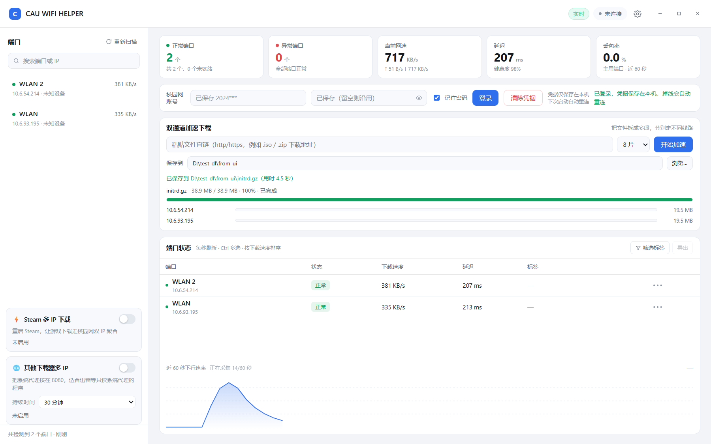

# 双通道分片下载：实现与实测

> 实现：`internal/accel`（下载器）+ `internal/control/accel.go`（控制面）+ `desktop/frontend/app/accel.js`（面板）
> 依赖：零第三方库
> 前情：[`parallel-download.md`](parallel-download.md)（为什么必须在客户端分片）、[`dual-path.md`](dual-path.md)（双源实测）

---

## 一、做成了什么

主界面「校园网账号」下方多了一块面板：



粘一个文件直链 → 程序先问服务器「支持 Range 吗、文件多长」→ 按片切开 → 每片各自从不同源 IP 下发 → 并发写进同一个文件 → 面板实时显示总速度与**每条 IP 各扛了多少字节**。

保存位置默认 `%USERPROFILE%\Downloads\caulink\`，同名自动加 `(1)`，绝不覆盖。面板上「保存到」可随时改成任意目录（浏览选择或直接粘路径），改完立即校验并记住。

### 实测（本机双网卡）

目标：清华 TUNA 的 `initrd.gz`，40.8 MB，`Accept-Ranges: bytes`，带 ETag。

| 场景 | 墙钟 | 速率 | 倍数 |
|---|---:|---:|---:|
| 单流 curl（第 1 次） | 7.19 s | 5.68 MB/s | 1.00× |
| 单流 curl（第 2 次） | 6.95 s | 5.87 MB/s | 1.03× |
| **双通道加速（第 1 次）** | **4.44 s** | **8.76 MB/s** | **1.50×** |
| **双通道加速（第 2 次）** | **4.44 s** | **8.77 MB/s** | **1.50×** |
| 双通道·自定义目录（界面里跑） | 4.5 s | 8.6 MB/s | — |

两条链路的分配（第 2 次）：

```text
WLAN 2@10.6.54.214   19.5 MB
WLAN@10.6.93.195     19.5 MB
```

内容校验：三次下载的 md5 全部是 `6b7d4330e0259939c24abad9ced5aff1`，与单流逐字节一致。

> 1.5× 而不是 2×，原因和双源实测里那条一样：两块网卡连的是同一台 AP（BSSID `ec:da:59:0e:0c:c0`，同 channel 44），空口时间共享。换到不同 AP 或改用有线+无线，这个数字才有机会接近 2×。

**注意面板里填的是 8 片，实际只开了 4 片**——这是刻意的：分片数不超过「IP 数 × 2」。同一 IP 上的第 3 片只会和前面两片抢同一份额度，纯属浪费。

---

## 二、为什么必须在客户端分片

代理的 CONNECT 隧道里跑的是 TLS 密文，看不到 HTTP 头，插不进 `Range`。想在代理层拆只能 MITM 解密——给用户装根证书、在校园网里解开别人的流量，合规上直接否决。所以「让下载变快」只能由程序自己当下载器。

反过来说，也不能指望「让一条连接跑两条线」：TCP 四元组在连接期内固定，单连接换源 IP 在协议层就不存在。真正的做法是**多条连接、每条各自钉死在一个 IP 上**，这是 IDM / aria2 的同一套思路。

---

## 三、实现要点（`internal/accel`）

| 环节 | 做法 | 为什么 |
|---|---|---|
| 能力探测 | `GET` + `Range: bytes=0-0`，读 `Content-Range` 拿总长 | 只花 1 个字节就能确认支不支持分段 |
| 不支持分段 | 返回 `200` 而不是 `206` → 自动退回单流 | 硬拆会拼出重复内容，坏文件比慢严重 |
| 一致性 | 每片带 `If-Range: <ETag>`，优先 ETag 而非 Last-Modified | 秒级精度会让「同一秒内被替换的文件」混进旧片 |
| 分片数 | `min(用户填的, IP 数 × 2)`，单片不小于 2 MiB | 超过 IP 数 2 倍没有收益；片太小握手开销吃掉收益 |
| 落盘 | `Truncate(total)` 预分配 + `io.NewOffsetWriter` 并发写 | 不预分配会留下「长度像下完、内容是空洞」的坏文件 |
| 失败重试 | 每片最多 3 次，**每次换下一个源 IP**，从已写位置续 | 换 IP 再试，而不是在同一条坏线路上死磕 |
| 不可重试 | 401/403/416、服务器忽略 Range、文件被改动 | 换 IP 只会更糟，或根本没有正确结果 |
| 取消/失败 | 删掉半成品文件 | 留着会让人以为下载成功了 |
| 记录 | `io.Copy` 每一段都 `metrics.AddDown(id, n)` | 面板「当前网速」与每端口曲线同步反映加速流量 |
| 保存目录 | 提交时校验并 `MkdirAll`，记住到 `data/accel.json` | 路径错了当场知道，而不是下完才发现写不进去 |

单任务串行：后来的任务排队（`queued`）。多任务并发只会互抢同一份额度，总速度不变，只是两个进度条都变慢。

---

## 四、接口契约（`internal/control/accel.go`）

```text
GET  /api/v1/accel/tasks
     → { defaults: {dir, connections, max_connections}, tasks: [ ... ] }

POST /api/v1/accel/tasks            (需 X-Caulink-Action: 1)
     { url, dir?, connections? } → 任务快照

POST /api/v1/accel/tasks/cancel     (需 X-Caulink-Action: 1)
     { id } → { ok: true }

POST /api/v1/accel/settings         (需 X-Caulink-Action: 1)
     { dir } → { dir }        校验 + 创建 + 记住（落盘 data/accel.json）
```

任务快照字段：`id / url / file / save_path / status / total_bytes / done_bytes / speed_bps / elapsed_seconds / channels[]`，其中 `channels[]` 每项是 `index / id / ip / bytes / done / error` —— 面板上「每条链路各扛多少」就是它。

`X-Caulink-Action` 这个头不是摆设：写操作不加校验，本机任意网页都能往你磁盘里塞文件。

---

## 五、代码清单

| 文件 | 行数 | 作用 |
|---|---:|---|
| `internal/accel/accel.go` | 531 | 任务管理、队列、快照、URL 规范化 |
| `internal/accel/chunk.go` | 516 | 探测、分片、抓取、重试、落盘、进度 |
| `internal/accel/dir.go` | 128 | 保存目录校验、展开、持久化 |
| `internal/accel/accel_test.go` | 332 | 分片规划、文件名、并行下载、无 Range、取消 |
| `internal/accel/dir_test.go` | 141 | 路径规范化、`~` 展开、重启后记住、损坏配置兜底 |
| `internal/control/accel.go` | 168 | 四个 HTTP 端点 + 鉴权 |
| `internal/control/accel_test.go` | 272 | 501/403/200/404 与设置端点 |
| `internal/control/status.go` | +7 | 挂载路由与 `Accel` 字段 |
| `cmd/caulinkd/main.go` | +23 | 构造 Manager、注入状态服务与目录状态文件 |
| `desktop/frontend/app/accel.js` | 507 | 面板（自带样式，不碰 app.js） |
| `desktop/frontend/app/index.html` | +1 | 引入脚本 |

零第三方依赖。桌面端面板单独成文件，是因为 `app.js` 已经 1470 行，往里塞新模块的回归风险大于收益。

---

## 六、怎么重建发布包

```bash
# 1) 界面：先用 wails3 生成带图标/版本信息的 syso，再 build
cd desktop
wails3 generate syso -arch amd64 -icon build/windows/icon.ico \
    -manifest ../tools/launcher/launcher.manifest -info ../tools/launcher/info.json \
    -out ui.syso
go build -tags production -trimpath -buildvcs=false \
    -ldflags="-w -s -H windowsgui" -o caulink-ui.exe .
rm ui.syso

# 2) 守护进程 / 认证器
cd ..
go build -trimpath -buildvcs=false -ldflags="-w -s" -o caulinkd.exe ./cmd/caulinkd
go build -trimpath -buildvcs=false -ldflags="-w -s" -o caulink-auth.exe ./cmd/caulink-auth

# 3) 启动器（源码与构建说明在 tools/launcher/）
cd tools/launcher
wails3 generate syso -arch amd64 -icon ../../desktop/build/windows/icon.ico \
    -manifest launcher.manifest -info info.json -out launcher.syso
go build -trimpath -buildvcs=false -ldflags="-w -s -H windowsgui" -o "CAU WIFI HELPER.exe" .
```

发布包 v0.2.0 的四个 exe 版本信息都是 `CAU WIFI HELPER 0.2.0`：

```text
CAU WIFI HELPER.exe   启动器    3.6 MB
caulink-ui.exe        界面     12.2 MB
caulinkd.exe          服务      8.5 MB
caulink-auth.exe      认证      7.0 MB
```

---

## 七、验证做了什么

1. **单元测试 12 个**（`go test ./internal/accel/ ./internal/control/`）：分片覆盖不重叠、`Content-Range` 解析、文件名清洗、重名加序号、4 MiB 并行下载逐字节比对、服务器不支持 Range 时退回单流、取消后不留文件、非法 URL 拒绝、端点 501/403/200/404。
2. **真机端到端**：守护进程 + 两网卡认证在线 → 提交任务 → 40.8 MB 下载 4.44 s / 8.76 MB/s → md5 与单流一致 → 每链路 19.5 MB。
3. **界面路径**：用 WebView2 的 CDP 端口真实操作面板（填 URL → 点「开始加速」），读取面板文本确认进度、速度、每链路字节数都在更新，并截图。
4. **启动器路径**：双击 `CAU WIFI HELPER.exe` → 校正配置 → 拉起守护进程（`caulinkd 已就绪`）→ 打开界面，全链路正常。
5. **自定义保存目录**：
   - 接口层：无 `X-Caulink-Action` → 403；正常 → 200 且目录被创建；相对路径/空路径 → 400 并给出可读原因。
   - 持久化：改完写进 `data/accel.json`，重启守护进程后 `defaults.dir` 仍是新目录；配置文件损坏时退回默认目录、不影响启动。
   - 界面路径：在面板里改目录，失焦后提示「已更新」，下载完成后文件确实落在该目录，md5 与单流一致。
6. **全仓回归**：`go test ./...` 23 个包全绿（含 `dir_test.go` 的 4 个新用例）。

---

## 八、已知限制（写清楚，别让人踩坑）

1. **单 IP 不加速**。限速锚定 IP，8 条连接在同一个 IP 上只有 0.98×（已实测）。面板照常能跑，只是快不起来——这不是 bug。
2. **只支持直链**。网盘分享页、需要登录态/防盗链的地址会在探测阶段报 `站点拒绝访问（HTTP 403）`。
3. **保存目录必须是绝对路径**。相对路径会被拒绝——它相对的是守护进程的工作目录，用户根本猜不到文件落在哪。
4. **无断点续传**。取消或失败会删掉半成品；重来一次从头下。
5. **单任务串行**。第二个任务排队，不会两个一起跑。
6. **代理功能与加速互不影响**：加速流量走自己的连接，不经过 1080/8080，但会计入面板统计。

## 九、保存目录：怎么选、记在哪

```text
保存到  [D:\Downloads\caulink                ] [浏览…]
```

- **浏览…** 调的是 Wails 运行时的原生目录选择框（`Dialogs.OpenFile` 配 `CanChooseDirectories`）。面板是零构建的原生 JS，没有打包 `@wailsio/runtime`，所以用 `import('/wails/runtime.js')` 拿同一份模块实例；拿不到（比如在普通浏览器里调界面）就提示手动粘贴路径，不会把面板卡死。
- **立刻校验**：`NormalizeDir` 会去掉复制粘贴带进来的引号、展开 `~` 和 `%USERPROFILE%`、拒绝相对路径与「指向文件」的路径，并顺手把目录建出来。错误直接回显在面板上，不用等下完才发现写不进去。
- **记住**：目录存进 `<data_dir>/accel.json`（`0600`），重启守护进程/重启电脑都会读回来。文件损坏就退回默认目录，不影响启动。
- **提交任务时带的 `dir` 优先**：界面把输入框里的值随任务一起发过去，所以「改了没失焦就点开始」也不会用错目录。

## 十、下一步可做（按性价比）

1. 续传：把分片表（偏移 + 已完成字节 + ETag）写成 JSON，重启接着下。
2. 磁盘余量预检：`Truncate` 失败才发现空间不够，可以在开始前先查一次。
3. 每 IP 限速：给慢链路降权，让快链路多扛——现在已经是按片平均分配。
4. 换 AP 复测：把 1.50× 变成接近 2× 的唯一办法是让两条链路不共享上游。
